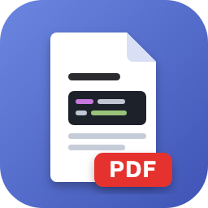
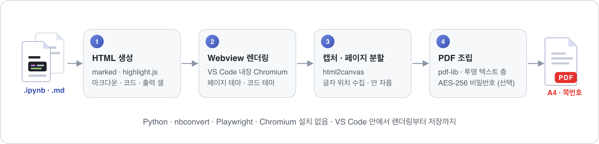
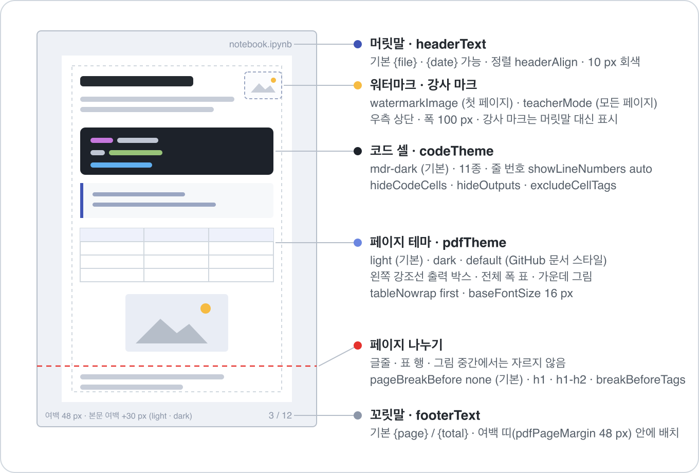
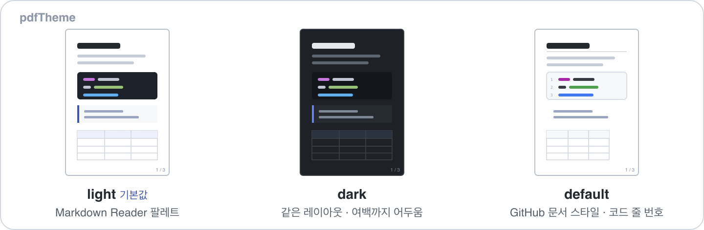

<div align="center">



# Ipynb PDF Converter

**Jupyter 노트북(.ipynb)과 마크다운(.md)을 우클릭 한 번으로 종이 규격 PDF로.**

Python도 Chromium도 설치하지 않습니다. VS Code 안에서 렌더링부터 저장까지 끝냅니다.

[](https://marketplace.visualstudio.com/items?itemName=leekh.ipynb-pdf-converter)
[](https://marketplace.visualstudio.com/items?itemName=leekh.ipynb-pdf-converter)
[](https://github.com/leekh4232/ipynb-to-pdf-converter/releases)


[](https://ipynb-to-pdf.hossam.kr/)
[](LICENSE)

🌐 **소개 페이지 · [ipynb-to-pdf.hossam.kr](https://ipynb-to-pdf.hossam.kr/)**

</div>

<br>



> 아이티윌 이광호 강사의 수업용으로 만들었습니다. `nb_convert.py`와 같은 결과를 VS Code에서 냅니다.

## 한눈에 보기

| | |
|:--|:--|
| 🖱️ **우클릭 한 번** | 탐색기 · 에디터 탭 · 편집기 본문 · 노트북 셀 · 명령 팔레트 어디서든. 탐색기에서 여러 파일을 골라 한꺼번에 변환 |
| 📐 **용지 규격** | A3 · A4 · A5 · B4 · B5 · Letter · Legal · 16:9 와이드 · 태블릿 7종(iPad · Galaxy Tab), 세로/가로 |
| ✂️ **똑똑한 페이지 나누기** | 글줄 · 표 행 · 그림 중간에서는 자르지 않음 |
| 🎨 **테마** | 페이지 테마 3종, 코드 하이라이트 11종 |
| 📋 **텍스트 복사 · 검색** | 보이는 글자를 드래그해서 복사하고 PDF 뷰어에서 검색할 수 있음. 코드 들여쓰기도 그대로 복사됨 |
| 🖼️ **이미지 그대로** | 상대·절대 경로, `file:` · `http(s)` URL, 셀 첨부(`attachment:`) 모두 PDF에 포함. SVG는 보이는 크기 그대로 페이지 해상도로 그려 넣음. 못 찾은 이미지는 경고 |
| 🔒 **비밀번호** | AES-256 암호화, 열람 비밀번호와 권한(인쇄 · 복사 · 수정 · 주석) |
| 📦 **의존성 0** | Python · nbconvert · Playwright · Chromium 설치 불필요 |
| 🌐 **한국어 UI** | VS Code 표시 언어가 한국어면 한글, 그 외에는 영어 |

## 설치

Marketplace에서 **Ipynb PDF Converter**를 검색하거나, 명령 팔레트(`Ctrl/Cmd+P`)에서:

```
ext install leekh.ipynb-pdf-converter
```

## 사용 방법

1. `.ipynb` 또는 `.md` 파일을 **우클릭**합니다. 탐색기에서 여러 파일을 선택한 채 우클릭하면 선택한 파일을 모두 차례로 변환합니다.
2. **PDF로 변환**(Convert to PDF) 메뉴에서 명령을 고릅니다.

   | 한국어 UI | English UI | 하는 일 |
   |:--|:--|:--|
   | 노트북/마크다운을 PDF로 변환 | Convert Notebook/Markdown to PDF | 비밀번호 없이 변환. 설정에 기본 비밀번호가 있어도 쓰지 않음 |
   | … (비밀번호) | … (with Password) | 설정의 기본 비밀번호로 암호화. 비어 있으면 팝업으로 입력. 여러 파일이면 한 번만 묻고 모든 PDF에 같은 비밀번호를 씀 |
   | … (hossam) · … (jussam) | 같음 | `teacherMode`를 켜면 추가. 강사 마크를 모든 페이지 우측 상단에 넣음(비밀번호 유무 각각) |

3. 같은 폴더에 `.pdf`가 생깁니다. 같은 이름이 있으면 `이름 (1).pdf`, `이름 (2).pdf`처럼 번호를 붙이고 덮어쓰지 않습니다.

`.md`의 `---`로 감싼 머리글(YAML front matter)은 PDF에 넣지 않습니다. 맨 위 머리글(예: `theme` · `title` · `layout`)과 Slidev 슬라이드마다 붙는 `layout: two-cols` 같은 블록이 모두 빠지고, 코드 블록 안의 예시는 그대로 남습니다.

설치 뒤 VS Code의 확장 자동 업데이트(`extensions.autoUpdate`)가 꺼져 있으면 처음 한 번 켤지 묻습니다. **Turn on auto-update**를 누르면 사용자 설정이 켜지고, **Not now**를 누르면 다시 묻지 않습니다.

변환 중에는 알림 영역에 진행률(렌더링 → 페이지 캡처 → PDF 조립 → 저장)이 보이고 취소할 수 있습니다. 여러 파일을 변환할 때는 `(2/5)`처럼 순서가 보이고, 취소하면 남은 파일도 멈추며, 끝나면 요약 알림 하나만 뜹니다. 출력 창은 자동으로 열리지 않으며, 오류나 이미지 누락 알림의 **Show Log** 버튼으로 엽니다.

## 설정

설정 UI에서 **Ipynb PDF Converter** 섹션을 열면 중요도순으로 나옵니다. 자주 쓰는 값만 `settings.json`에 적으면:

```json
{
  "ipynb-pdf-converter.pdfTheme": "light",
  "ipynb-pdf-converter.codeTheme": "mdr-dark",
  "ipynb-pdf-converter.pdfPageSize": "A4",
  "ipynb-pdf-converter.pdfPageOrientation": "portrait",
  "ipynb-pdf-converter.pdfPageMargin": 48,
  "ipynb-pdf-converter.headerText": "{file}",
  "ipynb-pdf-converter.footerText": "{page} / {total}",
  "ipynb-pdf-converter.pdfPassword": ""
}
```





전체 설정은 아래를 펼쳐 보세요. 설정 이름 앞에는 모두 `ipynb-pdf-converter.`가 붙습니다.

<details>
<summary><b>모양 · 용지</b></summary>

| 설정 | 기본값 | 설명 |
|:--|:--|:--|
| `pdfTheme` | `light` | `light` · `dark`는 Markdown Reader 팔레트(`nb_convert.py --theme`와 동일, `dark`는 여백까지 어두움). `default`는 GitHub 문서 스타일. 코드 셀은 항상 `codeTheme`을 따름 |
| `codeTheme` | `mdr-dark` | `nb_convert.py --code-theme dark`와 동일. `mdr-light` · `dracula` · `github` · `github-dark` · `atom-one-light` · `atom-one-dark` · `monokai` · `nord` · `vs2015` · `leekh`(`default` 테마에서 제목·표·출력까지 A4 인쇄 스타일로) |
| `pdfPageSize` | `A4` | `A3` · `A5` · `B4`(JIS 257×364 mm) · `B5`(JIS 182×257 mm) · `Letter` · `Legal` · `Widescreen`(16:9 슬라이드, 가로 방향과 함께) · 태블릿 `iPadPro13` · `iPadPro11` · `iPadAir13` · `iPad11`(iPad/iPad Air 11") · `iPadMini` · `GalaxyTabS11`(11") · `GalaxyTabS11Ultra`(S11 Ultra/S12 Ultra). 태블릿은 화면의 논리 크기(CSS px, 예: Galaxy Tab S11 = 800×1280)라 100%에서 화면에 꽉 참 |
| `pdfPageOrientation` | `portrait` | `landscape` |
| `pdfPageMargin` | `48` | 페이지 여백(CSS px, 48 = 0.5 in). `light` · `dark`는 그 안쪽에 본문 여백 30 px를 더함(좌우는 모든 페이지, 위아래는 문서 처음·끝) |

</details>

<details>
<summary><b>출력 파일</b></summary>

| 설정 | 기본값 | 설명 |
|:--|:--|:--|
| `outputDirectory` | 비움 | 비우면 원본 옆. 상대 경로(`pdf`)는 원본 폴더 기준, 절대 경로 가능. 없으면 만듦 |
| `outputFileName` | `{name}` | `{name}` 원본 이름, `{date}` 날짜(YYYY-MM-DD) |
| `openAfterConvert` | `false` | 변환 후 시스템 뷰어로 열기 |

</details>

<details>
<summary><b>머릿말 · 꼬릿말</b> (페이지 여백 띠 안, 회색)</summary>

| 설정 | 기본값 | 설명 |
|:--|:--|:--|
| `headerText` | `{file}` | `{file}` `{date}` `{page}` `{total}` 사용 가능. 비우면 표시 안 함 |
| `footerText` | `{page} / {total}` | 위와 같음 |
| `headerAlign` · `footerAlign` | `right` | `left` · `center` · `right` |
| `headerFooterFontSize` | `10` | 글자 크기(CSS px) |

</details>

<details>
<summary><b>페이지 나누기 · 내용 선택</b> (노트북)</summary>

| 설정 | 기본값 | 설명 |
|:--|:--|:--|
| `pageBreakBefore` | `none` | 제목 앞에서 나누지 않음. `h1`(`nb_convert.py` 규칙) · `h1-h2`. 문서 맨 위의 제목은 빈 페이지를 만들지 않음. 글줄·표 행·그림은 어떤 설정에서도 잘리지 않음 |
| `breakBeforeTags` | `[]` | 이 태그가 달린 셀부터 새 페이지(예 `["pagebreak"]`) |
| `hideCodeCells` | `false` | 코드 셀 소스 숨김(출력은 유지) |
| `hideOutputs` | `false` | 모든 출력 숨김 |
| `excludeCellTags` | `[]` | 이 태그가 달린 셀은 통째로 제외(예 `["hide", "answer"]`). 학생 배포본에서 정답 셀 빼기 |

</details>

<details>
<summary><b>표 · 코드 · 글꼴</b></summary>

| 설정 | 기본값 | 설명 |
|:--|:--|:--|
| `tableNowrap` | `first` | 첫 열만 한 줄(`nb_convert.py`와 동일). `all`은 모든 셀 한 줄(넓은 표는 넘칠 수 있음). `none` |
| `showLineNumbers` | `auto` | `default` 테마에서만 표시. `on` · `off` |
| `baseFontSize` | `16` | 루트 글자 크기(CSS px). 문서의 모든 크기가 이 값에 비례 |
| `bodyFontFamily` · `codeFontFamily` | 비움 | CSS font-family 문자열. 비우면 테마 기본(본문 Helvetica Neue + Noto Sans CJK KR, 코드 Menlo) |

</details>

<details>
<summary><b>이미지 품질 · 파일 크기</b></summary>

| 설정 | 기본값 | 설명 |
|:--|:--|:--|
| `imageFormat` | `png` | 무손실. `jpeg`는 보통 1/4 이하 크기 |
| `jpegQuality` | `85` | 10-100 |
| `deviceScaleFactor` | `3` | 렌더링 배율 1-5 |

</details>

<details>
<summary><b>보안</b> (<code>(비밀번호)</code> 명령에서만)</summary>

| 설정 | 기본값 | 설명 |
|:--|:--|:--|
| `pdfPassword` | 비움 | 비우면 실행 때마다 팝업. `settings.json`에 평문으로 저장됨. 암호화는 AES-256 |
| `pdfPermissions` | `["annot-forms"]` | 열람자에게 허용할 작업 `print` · `copy` · `modify` · `annot-forms`(`nb_convert.py`와 동일). 텍스트 복사를 허용하려면 `copy`를 넣음 |
| `ownerPassword` | 비움 | 비우면 PDF 비밀번호(`pdfPassword` 또는 팝업 입력값)와 같음. 이때는 그 비밀번호를 아는 사람에게 `pdfPermissions` 제한이 적용되지 않음 |

</details>

<details>
<summary><b>표지 · 워터마크</b></summary>

| 설정 | 기본값 | 설명 |
|:--|:--|:--|
| `coverPage` | `false` | 한 페이지 표지 |
| `coverTitle` · `coverSubtitle` · `coverAuthor` | `{file}` · 비움 · 비움 | `{file}` `{date}` 사용 가능 |
| `watermarkImage` | 비움 | 첫 페이지 우측 상단에 고정할 이미지(원본 기준 상대 경로 · 절대 경로 · URL, `nb_convert.py --ssam`에 해당) |
| `watermarkWidth` | `100` | 폭(CSS px) |

</details>

<details>
<summary><b>고급 · teacher mode</b></summary>

| 설정 | 기본값 | 설명 |
|:--|:--|:--|
| `allowRemoteImages` | `true` | 문서가 참조하는 http(s) 이미지 내려받기 |
| `renderTimeoutSeconds` | `60` | 웹뷰 렌더링 제한 시간. 긴 노트북이면 올리기 |
| `teacherMode` | `false` | 우클릭 메뉴·명령 팔레트에 `(hossam)` · `(hossam, 비밀번호)` · `(jussam)` · `(jussam, 비밀번호)` 변환 명령 추가. `nb_convert.py --ssam`처럼 강사 마크(`https://data.hossam.kr/itwill-ho.png` / `itwill-ju.png`, 폭 100 px)를 모든 페이지 우측 상단 여백에 그리며, 이때 `headerText`는 표시하지 않음(꼬릿말은 유지) |

</details>

## 다른 확장에서 쓰기

`activate`가 내보내는 `convertToPdfBytes` API를 부르면 같은 파이프라인으로 PDF 바이트를 돌려받습니다. 파일은 만들지 않습니다. **PDF2Note**가 이 API로 `.ipynb` · `.md`에 필기 영역을 붙입니다.

## 개발자 · 라이선스

**이광호** (leekh4232@gmail.com) · [MIT](LICENSE)
